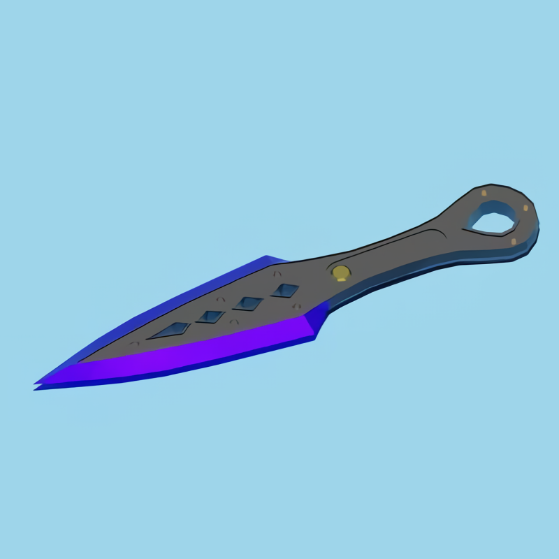

<script src="../assets/fit.js"></script>

<!-- _class: title simple -->
<!-- _header: 'イベント名 2026/03/20' -->

# <span class="nf" style="color: #222; --icon-offset-y: 4px" aria-label="Rust">&#xe7a8;</span> プレゼンテーションのタイトル

 n4mlz

[@n4mlz](https://github.com/n4mlz) [@n4mlz](https://x.com/n4mlz)

---

<!-- header: はじめに -->

# 箇条書きの例

- 項目 1: **強調した文字**
  - 補足する項目
- 項目 2: 説明文をここに書きます
- 項目 3: 説明文をここに書きます
- 項目 4: 説明文をここに書きます

---

<!-- header: 表の例 -->

# 表のあるスライド

- 表の内容を説明する文章

|  | 列 1 | 列 2 |
| --- | --- | --- |
| 行 1 | 内容 A | 内容 B |
| 行 2 | 内容 C | 内容 D |

---

<!-- header: レイアウトの例 -->

# 2カラムとコード

<div class="columns">
<div>

- 左右に内容を配置
- **青緑**で強調

</div>
<div>

```rust
fn main() {
    println!("Hello, Marp!");
}
```

</div>
</div>

---

<!-- _class: section-title -->
<!-- header: まとめ -->

# まとめ

---

# まとめ

- Markdownを使ってスライドを作成
- 表やコードブロックも使える
- 図や画像は必要に応じて追加

---

<!-- header: 自動調整 -->

# 文字量に合わせた自動縮小

<div class="fit">
<div>

- 内容が領域より長いとき、自動で文字を小さくします。
- 短い文章は元の大きさのまま表示します。
- 項目 3: ここに内容を記載します。
- 項目 4: ここに内容を記載します。
- 項目 5: ここに内容を記載します。
- 項目 6: ここに内容を記載します。
- 項目 7: ここに内容を記載します。
- 項目 8: ここに内容を記載します。

</div>
</div>
